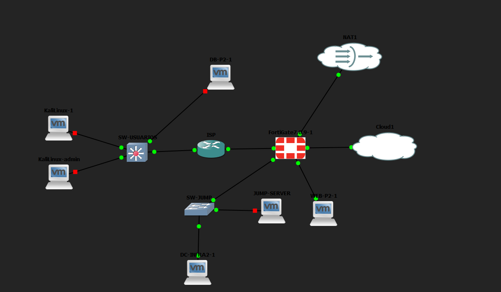
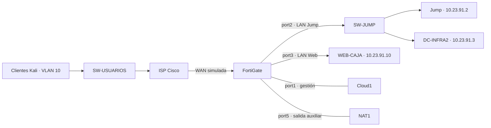
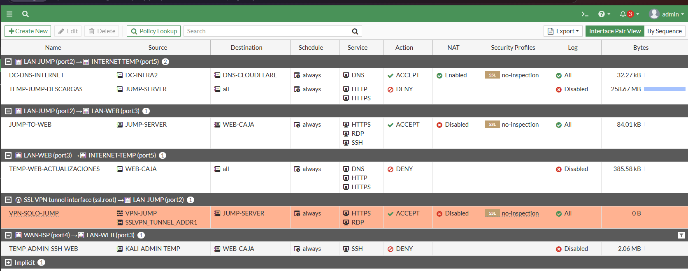

# Infraestructura 2 · VPN, Jump y RemoteApp HTML5

**Axel Enrique Vasquez Peña · Matrícula 2024-2388**  
Semana 4 · Práctica 3 · Seguridad de Redes

## Video de demostración

**[Ver video: Infraestructura 2](https://youtu.be/GgioDwhGxQY)**

El video es la demostración entregada por el autor. La duración máxima solicitada es de 10 minutos; no se verificó su duración desde el reproductor disponible durante la preparación de este repositorio.

## Objetivo y alcance

Separar usuarios y servidores, permitir acceso remoto por VPN únicamente al servidor Jump y aplicar permisos diferentes a usuarios normales y privilegiados. FortiGate controla el tráfico entre segmentos; Windows en Jump aplica el bloqueo selectivo de TCP/22 por grupo de dominio. El portal HTML5 publica las aplicaciones autorizadas.

Esta entrega documenta la implementación y las pruebas realmente observadas. **Es una implementación parcial**: Caja como RemoteApp y RDP de Jump a Web no funcionaron en las pruebas finales. Por decisión del autor se conservaron esos fallos sin repararlos.

## Topología

La imagen conserva el estado original de GNS3 y no demuestra que todos los equipos estuvieran encendidos. DB-P2 permanece dibujado, pero está fuera de uso. Su base de datos fue migrada a WEB-P2.

| Segmento / equipo | Dirección | Función |
|---|---|---|
| Usuarios, VLAN 10 | 10.23.90.0/25; gateway 10.23.90.1 | Clientes con DHCP del ISP |
| Kali administración observada | 10.23.90.11/25 | Cliente de pruebas VPN |
| WAN simulada | 198.51.100.0/30 | ISP .1; FortiGate port4 .2 |
| LAN Jump | 10.23.91.0/29 | Gateway FortiGate port2: 10.23.91.1 |
| Jump | 10.23.91.2/29 | RDS, RDWeb, HTML5, Gateway; DNS 10.23.91.3 |
| DC-INFRA2 | 10.23.91.3/29 | AD DS y DNS, dominio infra2.test |
| LAN Web | 10.23.91.8/29 | Gateway FortiGate port3: 10.23.91.9 |
| WEB-CAJA / WEB-P2 | 10.23.91.10/29 | Ubuntu, Nginx, PHP, MariaDB, SSH, xrdp |
| Pool VPN | 10.212.134.200–210 | Dirección observada: 10.212.134.200 |
| Gestión FortiGate | 192.168.6.140, DHCP observado | port1, Cloud1 |
| Salida auxiliar | port5 → NAT1 | DNS autorizado y descargas temporales |

El archivo [enlaces-topologia.csv](enlaces-topologia.csv) se deriva del proyecto GNS3 local. Este repositorio contiene documentación, no una exportación portátil con imágenes y discos de máquinas virtuales.

## Política final de FortiGate

| Política | Origen → destino | Servicios | Estado observado |
|---|---|---|---|
| VPN-SOLO-JUMP | ssl.root, grupo VPN-JUMP y pool VPN → Jump | HTTPS, RDP | ACCEPT, sin NAT, log All |
| JUMP-TO-WEB | Jump → Web | HTTPS, SSH, RDP | ACCEPT, sin NAT, log All |
| DC-DNS-INTERNET | DC-INFRA2 → 1.1.1.1, port5 | DNS | ACCEPT con NAT, log All |
| TEMP-JUMP-DESCARGAS | Jump → Internet, port5 | HTTP, HTTPS | DENY |
| TEMP-WEB-ACTUALIZACIONES | Web → Internet, port5 | DNS, HTTP, HTTPS | DENY |
| TEMP-ADMIN-SSH-WEB | Cliente Kali → Web, port4 a port3 | SSH | DENY |
| Implícita | Tráfico sin coincidencia | Resto | Denegación |

Las reglas temporales se cambiaron a **DENY**, no se deshabilitaron. Las capturas finales muestran su registro desactivado. Que una política permita RDP no demuestra que el servicio sea accesible: la prueba final de TCP/3389 de Jump a Web falló.

## Identidad y aplicaciones

| Cuenta de dominio | Grupo | Aplicaciones visibles |
|---|---|---|
| usuario | RDS-USUARIOS | Sistema de Caja |
| operador | RDS-PRIVILEGIADOS | Sistema de Caja, PuTTY y Conexión a Escritorio remoto |

Las cuentas VPN son vpn-usuario y vpn-admin, pertenecientes a VPN-JUMP. La autenticación VPN y la autenticación del dominio son independientes. No se documentó una vinculación obligatoria entre cada cuenta VPN y su cuenta de dominio.

La regla local **Bloquear SSH RDS-USUARIOS** en Jump bloquea conexiones salientes TCP al puerto remoto 22, en todos los perfiles, usando el SID del grupo RDS-USUARIOS como filtro LocalUser. No equivale a bloquear cualquier protocolo encapsulado o SSH en puertos alternativos. [Evidencia de la regla](regla-ssh-por-grupo.png).

## Pruebas observadas

| Prueba | Resultado | Evidencia |
|---|---|---|
| VPN vpn-admin | Túnel activo, ppp0, IP 10.212.134.200 | [Captura](vpn-admin-conectada.png) |
| VPN a Jump | Ruta ppp0; TCP/443 y TCP/3389 abiertos | [Captura](vpn-jump-permitido.png) |
| VPN directamente a Web | Ruta temporal /32 por ppp0; TCP/22, 443 y 3389 expiran | [Captura](vpn-web-directo-timeout.png) |
| PuTTY HTML5 desde Kali | SSH a web-caja, hostname confirmado | [Captura](html5-ssh-desde-kali.png) |
| VPN vpn-usuario | Túnel autenticado y activo | [Captura](vpn-usuario-conectada.png) |
| Usuario normal en HTML5 desde Kali | Solo icono de Caja visible | [Captura](html5-usuario-normal.png) |
| TCP/22 desde Jump como usuario | TcpTestSucceeded: False | [Captura](ssh-usuario-bloqueado.png) |
| TCP/22 desde Jump como operador | TcpTestSucceeded: True | [Captura](ssh-operador-permitido.png) |
| RDWeb por nombre desde DC | Página con candado después de importar CER | [Captura](rdweb-confianza-dc.png) |
| Caja dentro del escritorio de Jump | Página y ventas visibles | [Captura](caja-en-escritorio-jump.png) |
| RDP Jump → Web, prueba final | TcpTestSucceeded: False | [Captura](rdp-web-fallo-final.png) |

La ruta temporal hacia Web se retiró después de la prueba. Los timeouts, junto con las políticas y el contraste positivo hacia Jump, son consistentes con el aislamiento; no se incluye un registro de paquetes denegados que atribuya individualmente cada intento a una política. El contraste usuario/operador verifica el bloqueo selectivo del puerto 22 sin confundirlo con una caída del destino.

## Limitaciones reconocidas

- **Sistema de Caja como RemoteApp no abre** en las pruebas documentadas. Su icono visible no prueba su ejecución. La página sí abrió directamente en Edge dentro de Jump.
- **RDP desde Jump a Web falla en la prueba final**, aunque hubo una prueba previa exitosa. xrdp estaba escuchando; la causa final no se determinó.
- HTML5 con PuTTY sí se verificó desde Kali por la VPN. No se atribuye ese éxito a Caja.
- La VPN del laboratorio requirió TLS 1.0 y compatibilidad criptográfica antigua con certificado fijado. No es una configuración adecuada para producción.
- Se asignó el certificado autofirmado RDS-INFRA2 a los cuatro roles RDS y se importó su parte pública en DC-INFRA2. No se documentó la importación de confianza en Kali; la captura del navegador de Kali muestra un aviso junto al candado.
- **Licenciamiento RDS pendiente**: seleccionar modo por usuario no instala ni activa CAL. No se afirma tener un despliegue licenciado permanente.
- La página Caja conserva el texto antiguo «Base de datos central: DB-P2», aunque la base fue migrada localmente a Web.

## Archivos publicados

Topología, inventario de enlaces, políticas, resultados y capturas aportadas durante las pruebas. No se incluyen el guion, contraseñas, claves privadas, PFX, discos de VM, imágenes comerciales ni copias completas sin sanear de FortiGate.
